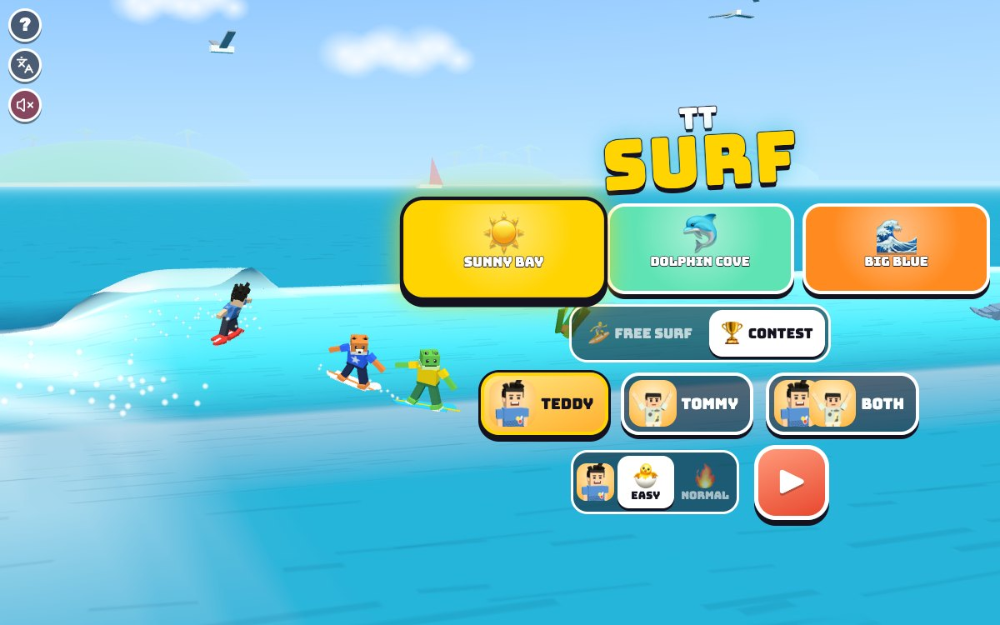

# TT Surf

Press **?** any time (or tap the round **?** button in the top left corner) to see the keys. The game waits while you look.
Tap the language button under it (the A文 icon) to switch between English and 中文; the dashboard and every game remember the choice.

**中文：** 冲浪：在大浪上滑上滑下，冲到浪顶飞起来，在空中转圈做技巧，跟海豚打招呼，躲开海草。可以自由冲浪，也可以和狐狸、青蛙比赛，或者兄弟俩在同一个浪上一起冲。

A surfing game for Teddy and Tommy. Ride a big curling wave as it peels along the beach: carve up and down its face, fly off the top, spin in the air and land it, say hi to the dolphins playing in the wave and dodge the seaweed, all while the white water chases you. **Free surf** for your best score, or surf a **contest** against Foxy 🦊 and Froggy 🐸, or both brothers on the same wave. Three waves, two levels, and the other brother always ready to swoop in and lift you onto a better wave.

It's built with Claude Code from plain JavaScript and Three.js, in the same style as Metro Surfer and the other Teddy & Tommy games. There are no image, model or audio files: the wave is rebuilt every frame from a few numbers, the dolphins, seaweed, islands and boards are boxes and canvas textures, Teddy and Tommy come from the shared kit (`kit/`), and every sound is synthesised.

The name lives in one place, [js/title.js](js/title.js).

## Play

- **Double-click `index.html`.** It works offline, because Three.js and the kit are copied into `kit/`. Without internet the logo falls back from the Bungee font to Arial Black.
- **Send one file:** `dist/surf-tt.html` is the whole game in one file. AirDrop or email it, then open it in a browser.
- **Rebuild that file** after any edit: `python3 kit/tools/bundle.py . --name surf-tt`
- **Get kit updates** from `~/claude-games/kit`: `python3 ../kit/tools/sync.py .`, then rebuild.
- **On the home screen** pick a wave, 🏄 FREE SURF or 🏆 CONTEST, who surfs (TEDDY, TOMMY or BOTH), 🐣 EASY or 🔥 NORMAL for each brother, then ▶. Behind the menu the chosen boy surfs the chosen wave, again and again.
- **Each ride** starts with 3, 2, 1, GO! and lasts as long as the wave (45 to 65 seconds, the clock is top right). Then 🏁 WAVE OVER!
- **The end:** the winner does his signature move on his board (Teddy's boxing combo, then his 🏀 jump shot; Tommy's Y with peace fingers ✌️) while confetti flies, then the results: 🥇 🥈 🥉, everyone's score, spins 🌀 and dolphins 🐬, NEW BEST! when you beat your best. 🔁 surfs again, ⏭️ goes to the next wave, 🏠 back home.
- **Saved per browser:** the wave, the mode, who surfs, each brother's level, the best score on every wave at each level, and each brother's 🏆 wins (shown on his button). `index.html` and `dist/surf-tt.html` each keep their own, because they're different ways of opening the game.

### The waves

| Wave | Height | Ride | Seaweed | Dolphins |
|---|---|---|---|---|
| ☀️ Sunny Bay | 2.6 m | 45 s | 7 | 4 |
| 🐬 Dolphin Cove | 3.3 m | 55 s | 10 | 9 |
| 🌊 Big Blue (at sunset) | 4.2 m | 65 s | 13 | 6 |

Each wave is made from a seed in [js/beaches.js](js/beaches.js), so it's the same every time. Bigger waves peel faster. Out behind the wave there are islands with palm trees, a little sailboat and seagulls.

### Surfing

- **Carve:** up the wave slows you down, down the wave speeds you up, like a skateboard ramp. A big swing from down to up (or back) is a **CARVE! +20**.
- **The pocket:** the wave pushes you along best near the curl, where it's breaking. Ride too far out on the flat shoulder and you slow down; fall behind into the white water and it shoves you back out (THE FOAM GOT YOU!).
- **Air:** carve up to the top fast enough and you fly off the lip (**AIR! +20**). Press the trick key just before the top for a bigger pop.
- **Tricks:** press the trick key in the air to spin, again and again while you're up there. Teddy spins with his jump shot, Tommy with his Y. **SPIN! +100, DOUBLE SPIN! +250, TRIPLE SPIN! +450**, then SUPER SPINS.
- **Dolphins 🐬:** they leap in and out of the wave. Surf right past one: **HI DOLPHIN! +50**, and it does a big happy jump with a 💙.
- **Seaweed:** it slows you down and wobbles you. Steer round it, or press the trick key on the wave for a little hop over it.

### Free surf and contest

- **🏄 FREE SURF:** just you and the wave, for your best score (with BOTH: the two brothers on the same wave, best score wins).
- **🏆 CONTEST:** you against Foxy 🦊 and Froggy 🐸 on the same wave (with BOTH: the two brothers and the two of them). Highest score wins.
- **2 players:** one screen, one wave, both brothers riding it together; the camera keeps both in view. Each brother picks his own level.

### Levels

| | 🐣 EASY (Tommy, 5) | 🔥 NORMAL (Teddy, 8) |
|---|---|---|
| Steering | back to the middle of the wave when you let go | stays where you point it |
| Airs | big floaty airs, always long enough for a spin | real gravity: carve hard for a big one |
| Landing a trick | always lands: your spin finishes as you touch down | land in the middle of a spin and you WIPEOUT! |
| Seaweed and dolphins | seaweed is easier to miss, dolphins say hi from further away | exact |
| Foxy and Froggy | they take it easy | a real contest |

## Controls

| | 1 player | Teddy (2 players) | Tommy (2 players) |
|---|---|---|---|
| Carve up the wave (hold) | W or ↑ | W | ↑ |
| Carve down the wave (hold) | S or ↓ | S | ↓ |
| Jump · trick in the air | Space, D, → or Enter | D or Space | → or Enter |
| Call your brother · high five | T | T | T |
| Pause | P or Esc | | |
| Sound on / off | M | | |

- **Home screen:** A D or ← → pick a wave, W S or ↑ ↓ pick the level (with BOTH, W S for Teddy, ↑ ↓ for Tommy), 1 2 3 pick who surfs, R switches free surf / contest, Enter or Space starts. On the results, Enter surfs again, N goes to the next wave, Esc or H goes home.
- **Touch:** hold ⬆ ⬇ to carve, tap ⭐ to jump and spin. Each brother has his own set, Teddy's on the left and Tommy's on the right. Tap your brother's face (or ✋ with two players) at the bottom.
- **The ? panel, the language button and the speaker** sit in a column in the top left corner, in the sky above the wave, away from the touch buttons.

## Companion

- **Call your brother any time, as often as you like:** press T or tap his face at the bottom of the screen (Kit.roster.buddyFor picks him: Tommy for Teddy, Teddy for Tommy).
- He pops up on his own surfboard beside you on the wave, at his buddy size, faces you and does his signature move: Tommy's Y ✌️, or Teddy's boxing and 🏀 jump shot.
- He tosses you a treat (🍦 💧 🧃 🍪 🍉 🍌): "🍪 COOKIE FROM TOMMY!"
- Then his helper: **"TOMMY SAYS: BIGGER WAVE!"** He throws both arms up and lifts you into the air, and a **better wave** rises under you: taller (bigger airs), faster, shimmering gold, and every point counts double (✨×2) for 9 seconds. He rides along behind you, then waves and pops off in a splash. Call him again whenever you like.
- **With two players,** T (or the ✋ button) is a high five: both brothers hold out a hand and both get a little push.

## How it was checked

- **`node tools/check.js`** (about 4 seconds), the same checks as `game.check()` in the page ([js/checks.js](js/checks.js)). Whole rides are surfed by pretend players (do nothing, a careful 8-year-old, a wobbly 5-year-old, mashing every button, and one who starts every trick too late):
  - **stable** (the wave physics): 60 rides on every wave at both levels, solo, with Foxy and Froggy and with 2 players, plus 40 seconds after each wave ends. Nothing ever becomes NaN, nobody leaves the face, speed stays between 3.8 and 14.4 m/s (the safety clamp is 24), nobody runs away from the wave or gets left in the white water (−7 to +21 m from the curl), a do-nothing surfer on EASY settles to a steady ride and nobody keeps speeding up, and the brother's better wave rises and settles smoothly (at most 4 cm per step under you).
  - **frames:** the same rides at 30, 60 and 144 frames a second and at a jumpy frame rate come out exactly the same (fixed 1/120 s physics steps).
  - **tricks** (tricks land on EASY): 447 different launches off the lip on EASY, the shortest air 1.13 s against a 0.42 s spin; a trick started at every moment of an air (every 0.02 s) lands and scores; 36 whole EASY rides of every kind (4 surfers each): 2353 tricks started, 2353 landed, 0 wipeouts. On NORMAL, late tricks do wipe out (42 times), so the landing rule is real.
  - **easyContest:** on EASY the wobbly 5-year-old beats Foxy and Froggy on every wave (12 contests).
  - **Each check is broken on purpose** and has to notice: the wave pushing the wrong way, nothing stopping you at the lip, the better wave appearing all at once, one physics step per frame, no landing help on EASY, EASY airs as heavy as a rock, landed tricks scoring nothing, and Foxy and Froggy going all out on EASY. All eight are caught.
- **In the browser** (muted): rides on every wave, both levels, 1 player and 2, keys and touch buttons (synthetic pointer events), the brother's visit (treat, lift, better wave), high fives, pause, the end of the wave and the results, through `game.step()`. 中文: every screen visited with `Kit.lang.untranslated()` returning [], and the toasts read one by one. English: no Chinese on the page except the kit's language button. No console errors. `index.html` and `dist/surf-tt.html` both open from `file://` in headless Chrome and play to the results with no page errors.
- **Layouts** in headless Chrome (`node tools/shoot.js tools/shots-layout.json <dir> <width> <height> <mobile>`): phone portrait 390x844, phone landscape 740x360, iPad 1024x768 and 820x1180. `docs/screenshot.jpg` is the title screen at 1200x750 (`node tools/shoot.js tools/shots.json docs 1200 750`).

## Files

- [index.html](index.html): the page, its styles and the menus.
- [js/title.js](js/title.js): the name.
- [js/beaches.js](js/beaches.js): the three waves (height, speed, seaweed, dolphins) and the shape of the face.
- [js/surf.js](js/surf.js): the rules with no drawing: carving, the wave's push, airs, tricks and landings, seaweed, dolphins, scores, the better wave, Foxy and Froggy, the pretend players.
- [js/checks.js](js/checks.js), [tools/check.js](tools/check.js): the headless checks.
- [js/world.js](js/world.js): the 3D sea, sky, islands, the wave and its curling lip, white water, seaweed, dolphins, seagulls, spray and sparkles.
- [js/surfer.js](js/surfer.js): the surfers (the kit's boys on boards, Foxy and Froggy), their stance, spins, wipeouts and celebrations.
- [js/game.js](js/game.js): the game: home, count-in, controls, camera, the brother's visit, the HUD, results.
- [js/keys.js](js/keys.js), [js/zh.js](js/zh.js): the ? panel and the 中文 words.
- [tools/shoot.js](tools/shoot.js): screenshots with headless Chrome.

## Not verified

- **Sound:** every test ran muted, so none of it has been heard; the sounds are checked in code only.
- **Real touch devices:** an iPhone or iPad, iOS Safari, two kids holding buttons at once on one iPad, and the frame rate on an older iPad (the wave is rebuilt every frame).
- **Real kids:** whether EASY is easy enough for Tommy, whether NORMAL is a good contest for Teddy, and whether a 65-second wave is too long.
- **The iPad home-screen icon** (🏄 on coral) and double-click from Finder.
